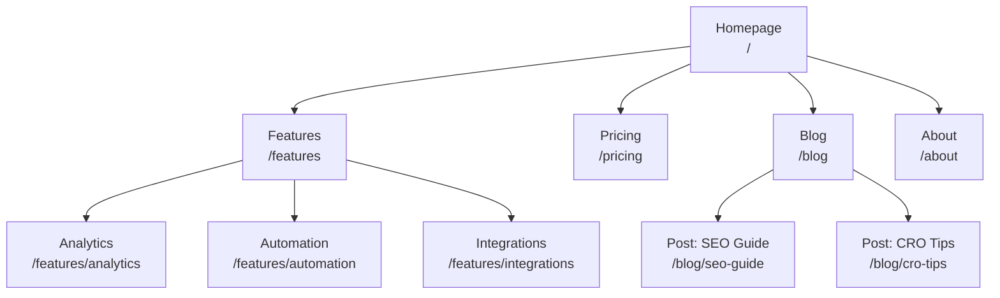
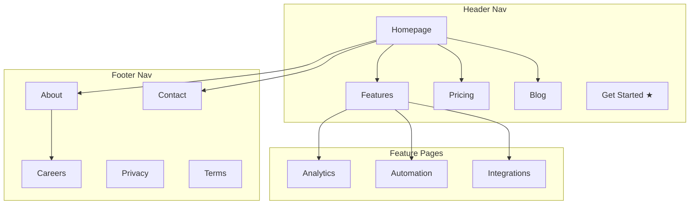
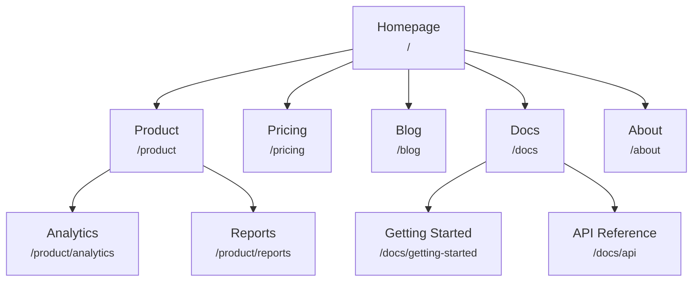
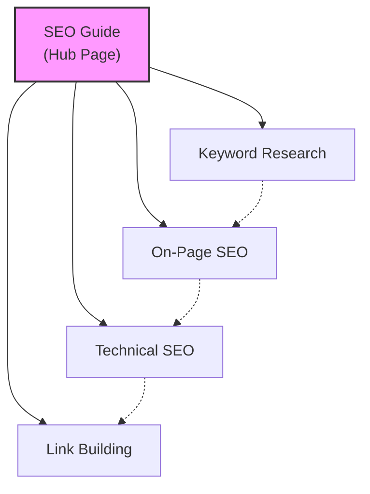
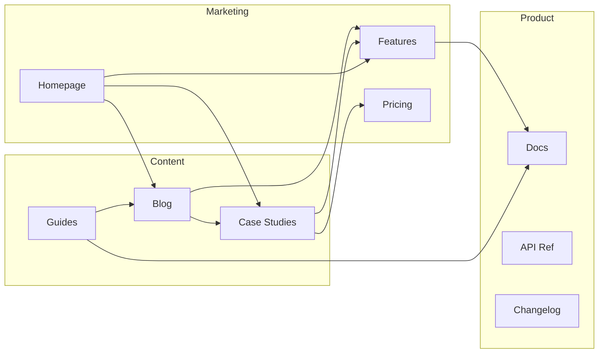
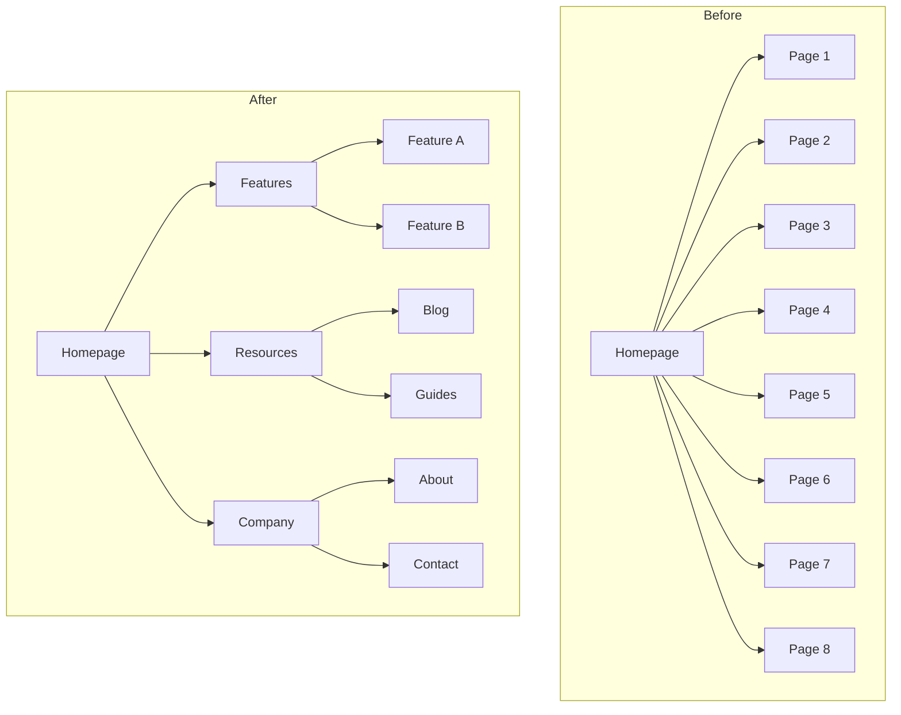
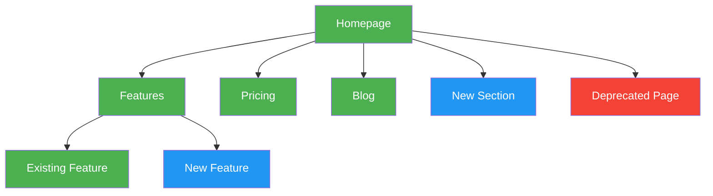

# Reference files for the `site-architecture` playbook

Each section below is one file from this playbook's `references/` folder. When GUIDE.md cites `references/<file>`, read the matching section here.


---

# references/mermaid-templates.md

# Mermaid Diagram Templates

Copy-paste-ready Mermaid diagrams for visual sitemaps. Customize node labels and connections for your site.

---

## Basic Hierarchy

Simple top-down page hierarchy.



---

## Hierarchy with Navigation Zones

Uses subgraphs to show which pages appear in which navigation area.



---

## Hierarchy with URL Labels

Each node shows the page name and URL path.



---

## Hub-and-Spoke Content Model

Shows a hub page connected to spoke articles, with spokes linking to each other.



Legend:
- Solid lines = primary hub-spoke links
- Dashed lines = cross-links between spokes

---

## Internal Linking Flow

Shows how different site sections link to each other.



---

## Before/After Restructuring

Compare current and proposed site structures side by side.



---

## Color-Coding Conventions

Use styles to highlight page status, priority, or type.



Color key:
- **Green** (`#4CAF50`): Existing pages (no changes)
- **Blue** (`#2196F3`): New pages to create
- **Red** (`#f44336`): Pages to remove or redirect
- **Yellow** (`#FFC107`): Pages to restructure or move
- **Purple** (`#9C27B0`): High-priority / CTA pages


---

# references/navigation-patterns.md

# Navigation Patterns

Detailed navigation patterns for different site types and contexts.

---

## Header Navigation

### Simple Header (4-6 items)

Best for: small businesses, simple SaaS, portfolios.

```
[Logo]   Features   Pricing   Blog   About   [CTA Button]
```

Rules:
- Logo always links to homepage
- CTA button is rightmost, visually distinct (filled button, contrasting color)
- Items ordered by priority (most visited first)
- Active page gets visual indicator (underline, bold, color)

### Mega Menu Header

Best for: SaaS with many features, e-commerce with categories, large content sites.

```
[Logo]   Product ▾   Solutions ▾   Resources ▾   Pricing   Docs   [CTA]
```

When "Product" is hovered/clicked:

```
┌─────────────────────────────────────────────────┐
│  Features           Platform        Integrations │
│  ─────────          ─────────       ──────────── │
│  Analytics           Security       Slack         │
│  Automation          API            HubSpot       │
│  Reporting           Compliance     Salesforce    │
│  Dashboards                         Zapier        │
│                                                   │
│  [See all features →]                             │
└─────────────────────────────────────────────────┘
```

Mega menu rules:
- 2-4 columns max
- Group items logically (by feature area, use case, or audience)
- Include a "See all" link at the bottom
- Don't nest dropdowns inside mega menus
- Show descriptions for items when labels alone aren't clear

### Split Navigation

Best for: apps with both marketing and product nav.

```
[Logo]   Features   Pricing   Blog        [Login]   [Sign Up]
├── Marketing nav (left) ──────┘          └── Auth nav (right) ──┤
```

Right side handles authentication actions. Left side handles page navigation.

---

## Footer Navigation

### Column-Based Footer (Standard)

Best for: most sites. Organize links into 3-5 themed columns.

```
┌──────────────────────────────────────────────────────────┐
│                                                          │
│  Product          Resources        Company       Legal   │
│  ─────────        ──────────       ─────────     ─────   │
│  Features         Blog             About         Privacy │
│  Pricing          Guides           Careers       Terms   │
│  Integrations     Templates        Contact       GDPR    │
│  Changelog        Case Studies     Press                 │
│  Security         Webinars         Partners              │
│                                                          │
│  [Logo]  © 2026 Company Name                             │
│  Social: [Twitter] [LinkedIn] [GitHub]                   │
│                                                          │
└──────────────────────────────────────────────────────────┘
```

### Minimal Footer

Best for: simple sites, landing pages.

```
┌──────────────────────────────────────────────────────────┐
│  [Logo]                                                  │
│  © 2026 Company  ·  Privacy  ·  Terms  ·  Contact        │
└──────────────────────────────────────────────────────────┘
```

### Expanded Footer

Best for: sites using footer for SEO (comparison pages, location pages, resource links).

```
┌──────────────────────────────────────────────────────────┐
│  Product     Resources    Compare         Use Cases      │
│  Features    Blog         vs Competitor A  For Startups  │
│  Pricing     Guides       vs Competitor B  For Enterprise│
│  API         Templates    vs Competitor C  For Agencies  │
│                                                          │
│  Integrations             Popular Posts                  │
│  Slack       Zapier       How to Do X                    │
│  HubSpot     Salesforce   Guide to Y                     │
│                           Template: Z                    │
│                                                          │
│  [Logo]  © 2026  ·  Privacy  ·  Terms  ·  Security      │
└──────────────────────────────────────────────────────────┘
```

---

## Sidebar Navigation

### Documentation Sidebar

Persistent left sidebar with collapsible sections.

```
Getting Started
  ├── Installation
  ├── Quick Start
  └── Configuration

Guides
  ├── Authentication
  ├── Data Models
  └── Deployment

API Reference
  ├── REST API
  │   ├── Users
  │   ├── Projects
  │   └── Webhooks
  └── GraphQL

Examples
  ├── Next.js
  ├── Rails
  └── Python

Changelog
```

Rules:
- Current page highlighted
- Sections collapsible (expanded by default for active section)
- Search at top of sidebar
- "Previous / Next" page navigation at bottom of content area
- Sticky on scroll (doesn't scroll away)

### Blog Category Sidebar

```
Categories
  ├── SEO (24)
  ├── CRO (18)
  ├── Content (15)
  ├── Paid Ads (12)
  └── Analytics (9)

Popular Posts
  ├── How to Improve SEO
  ├── Landing Page Guide
  └── Analytics Setup

Newsletter
  └── [Email signup form]
```

---

## Breadcrumbs

### Standard Format

```
Home > Features > Analytics
Home > Blog > SEO Category > How to Do Keyword Research
Home > Docs > API Reference > Authentication
```

Rules:
- Separator: `>` or `/` (be consistent)
- Every segment is a link except the current page
- Current page is plain text (not linked)
- Don't include the current page if the title is already visible as an H1

### With Schema Markup

```html
<nav aria-label="Breadcrumb">
  <ol itemscope itemtype="https://schema.org/BreadcrumbList">
    <li itemprop="itemListElement" itemscope itemtype="https://schema.org/ListItem">
      <a itemprop="item" href="/"><span itemprop="name">Home</span></a>
      <meta itemprop="position" content="1" />
    </li>
    <li itemprop="itemListElement" itemscope itemtype="https://schema.org/ListItem">
      <a itemprop="item" href="/features"><span itemprop="name">Features</span></a>
      <meta itemprop="position" content="2" />
    </li>
    <li itemprop="itemListElement" itemscope itemtype="https://schema.org/ListItem">
      <span itemprop="name">Analytics</span>
      <meta itemprop="position" content="3" />
    </li>
  </ol>
</nav>
```

Or use JSON-LD (recommended):

```json
{
  "@context": "https://schema.org",
  "@type": "BreadcrumbList",
  "itemListElement": [
    { "@type": "ListItem", "position": 1, "name": "Home", "item": "https://example.com/" },
    { "@type": "ListItem", "position": 2, "name": "Features", "item": "https://example.com/features" },
    { "@type": "ListItem", "position": 3, "name": "Analytics" }
  ]
}
```

---

## Mobile Navigation

### Hamburger Menu

Standard for mobile. All nav items collapse into a menu icon.

Rules:
- Hamburger icon (three lines) top-right or top-left
- Full-screen or slide-out panel
- CTA button visible without opening the menu (sticky header)
- Search accessible from mobile menu
- Accordion pattern for nested items

### Bottom Tab Bar

Best for: web apps, PWAs, mobile-first products.

```
┌──────────────────────────────────────┐
│                                      │
│           [Page Content]             │
│                                      │
├──────────────────────────────────────┤
│  Home    Search    Create    Profile │
│   🏠       🔍        ➕       👤    │
└──────────────────────────────────────┘
```

Rules:
- 3-5 items max
- Icons + labels (not just icons)
- Active state clearly indicated
- Most important action in the center

---

## Anti-Patterns

### Things to Avoid

- **Too many header items** (8+): causes decision paralysis, nav becomes unreadable on smaller screens
- **Dropdown inception**: dropdowns inside dropdowns inside dropdowns
- **Mystery icons**: icons without labels — users don't know what they mean
- **Hidden primary nav**: burying important pages in hamburger menus on desktop
- **Inconsistent nav between pages**: nav should be identical across the site (except app vs marketing)
- **No mobile consideration**: desktop nav that doesn't translate to mobile
- **Footer as sitemap dump**: 50+ links in the footer with no organization
- **Breadcrumbs that don't match URLs**: breadcrumb says "Products > Widget" but URL is `/shop/widget-pro`

### Common Fixes

| Problem | Fix |
|---------|-----|
| Too many nav items | Group into dropdowns or mega menus |
| Users can't find pages | Add search, improve labeling |
| High bounce from nav | Simplify choices, use clearer labels |
| SEO pages not linked | Add to footer or resource sections |
| Mobile nav is broken | Test on real devices, use hamburger pattern |

---

## Navigation for SEO

Internal links in navigation pass PageRank. Use this strategically:

- **Header nav links are strongest** — put your most important pages here
- **Footer links pass less value** but still matter — good for comparison pages, location pages
- **Sidebar links** help with section-level authority — good for blog categories, doc sections
- **Breadcrumbs** provide structural signals to search engines — implement with schema markup
- **Don't use JavaScript-only nav** — search engines need crawlable HTML links
- **Use descriptive anchor text** — "Analytics Features" not just "Features"


---

# references/site-type-templates.md

# Site Type Templates

Full page hierarchy templates with ASCII trees, URL maps, and navigation recommendations for common site types.

---

## SaaS Marketing Site

### Page Hierarchy

```
Homepage (/)
├── Features (/features)
│   ├── Feature A (/features/feature-a)
│   ├── Feature B (/features/feature-b)
│   └── Feature C (/features/feature-c)
├── Pricing (/pricing)
├── Customers (/customers)
│   ├── Case Study 1 (/customers/company-name)
│   └── Case Study 2 (/customers/company-name-2)
├── Resources (/resources)
│   ├── Blog (/blog)
│   │   └── [Posts] (/blog/post-slug)
│   ├── Templates (/resources/templates)
│   │   └── [Template] (/resources/templates/template-slug)
│   └── Guides (/resources/guides)
│       └── [Guide] (/resources/guides/guide-slug)
├── Integrations (/integrations)
│   └── [Integration] (/integrations/integration-name)
├── Docs (/docs)
│   ├── Getting Started (/docs/getting-started)
│   ├── Guides (/docs/guides)
│   └── API Reference (/docs/api)
├── About (/about)
│   ├── Careers (/about/careers)
│   └── Contact (/contact)
├── Compare (/compare)
│   └── [Competitor] (/compare/competitor-name)
├── Privacy (/privacy)
└── Terms (/terms)
```

### URL Map

| Page | URL | Nav Location | Priority |
|------|-----|-------------|----------|
| Homepage | `/` | Header (logo) | Critical |
| Features | `/features` | Header | High |
| Feature pages | `/features/{slug}` | Header dropdown | Medium |
| Pricing | `/pricing` | Header | Critical |
| Customers | `/customers` | Header | Medium |
| Case studies | `/customers/{slug}` | Customers dropdown | Medium |
| Blog | `/blog` | Header (Resources) | High |
| Blog posts | `/blog/{slug}` | — | Medium |
| Integrations | `/integrations` | Header | Medium |
| Docs | `/docs` | Header | Medium |
| Compare | `/compare/{slug}` | Footer | High (SEO) |
| About | `/about` | Footer | Low |
| Pricing CTA | `/pricing` | Header (CTA button) | Critical |

### Navigation

**Header (6 items + CTA)**: Features | Pricing | Customers | Resources | Integrations | Docs | [Get Started]

**Footer columns**:
- Product: Features, Pricing, Integrations, Changelog, Security
- Resources: Blog, Templates, Guides, Case Studies
- Company: About, Careers, Contact, Press
- Legal: Privacy, Terms, Security

---

## Content / Blog Site

### Page Hierarchy

```
Homepage (/)
├── Blog (/blog)
│   ├── [Category: Topic A] (/blog/category/topic-a)
│   ├── [Category: Topic B] (/blog/category/topic-b)
│   ├── [Category: Topic C] (/blog/category/topic-c)
│   └── [Posts] (/blog/post-slug)
├── Newsletter (/newsletter)
├── Resources (/resources)
│   ├── Guides (/resources/guides)
│   │   └── [Guide] (/resources/guides/guide-slug)
│   └── Tools (/resources/tools)
│       └── [Tool] (/resources/tools/tool-slug)
├── About (/about)
├── Contact (/contact)
├── Privacy (/privacy)
└── Terms (/terms)
```

### URL Map

| Page | URL | Nav Location | Priority |
|------|-----|-------------|----------|
| Homepage | `/` | Header (logo) | Critical |
| Blog index | `/blog` | Header | High |
| Categories | `/blog/category/{slug}` | Header dropdown | Medium |
| Posts | `/blog/{slug}` | — | Medium |
| Newsletter | `/newsletter` | Header (CTA) | High |
| Guides | `/resources/guides` | Header | Medium |
| About | `/about` | Header | Low |

### Navigation

**Header (4 items + CTA)**: Blog | Resources | About | Contact | [Subscribe]

**Sidebar** (on blog): Categories, Popular Posts, Newsletter signup

---

## E-Commerce

### Page Hierarchy

```
Homepage (/)
├── Shop (/shop)
│   ├── Category A (/shop/category-a)
│   │   ├── Subcategory (/shop/category-a/subcategory)
│   │   │   └── [Product] (/shop/category-a/subcategory/product-slug)
│   │   └── [Product] (/shop/category-a/product-slug)
│   ├── Category B (/shop/category-b)
│   │   └── [Product] (/shop/category-b/product-slug)
│   └── Category C (/shop/category-c)
│       └── [Product] (/shop/category-c/product-slug)
├── Collections (/collections)
│   └── [Collection] (/collections/collection-slug)
├── Sale (/sale)
├── Blog (/blog)
│   └── [Posts] (/blog/post-slug)
├── About (/about)
│   └── Our Story (/about/our-story)
├── Help (/help)
│   ├── FAQ (/help/faq)
│   ├── Shipping (/help/shipping)
│   ├── Returns (/help/returns)
│   └── Contact (/contact)
├── Cart (/cart)
├── Account (/account)
├── Privacy (/privacy)
└── Terms (/terms)
```

### URL Map

| Page | URL | Nav Location | Priority |
|------|-----|-------------|----------|
| Homepage | `/` | Header (logo) | Critical |
| Shop | `/shop` | Header | Critical |
| Categories | `/shop/{category}` | Header mega menu | High |
| Products | `/shop/{category}/{product}` | — | High |
| Collections | `/collections/{slug}` | Header | Medium |
| Sale | `/sale` | Header (highlighted) | High |
| Cart | `/cart` | Header (icon) | Critical |
| Account | `/account` | Header (icon) | Medium |

### Navigation

**Header (5 items + cart/account)**: Shop (mega menu) | Collections | Sale | Blog | Help | [Cart icon] [Account icon]

**Mega menu under Shop**: Category columns with featured products/images

---

## Documentation Site

### Page Hierarchy

```
Docs Home (/docs)
├── Getting Started (/docs/getting-started)
│   ├── Installation (/docs/getting-started/installation)
│   ├── Quick Start (/docs/getting-started/quick-start)
│   └── Configuration (/docs/getting-started/configuration)
├── Guides (/docs/guides)
│   ├── Guide A (/docs/guides/guide-a)
│   ├── Guide B (/docs/guides/guide-b)
│   └── Guide C (/docs/guides/guide-c)
├── API Reference (/docs/api)
│   ├── Authentication (/docs/api/authentication)
│   ├── Endpoints (/docs/api/endpoints)
│   └── Webhooks (/docs/api/webhooks)
├── Examples (/docs/examples)
│   └── [Example] (/docs/examples/example-slug)
├── Changelog (/docs/changelog)
└── FAQ (/docs/faq)
```

### URL Map

| Page | URL | Nav Location | Priority |
|------|-----|-------------|----------|
| Docs home | `/docs` | Header | High |
| Getting Started | `/docs/getting-started` | Sidebar (top) | Critical |
| Guides | `/docs/guides` | Sidebar | High |
| API Reference | `/docs/api` | Sidebar | High |
| Changelog | `/docs/changelog` | Sidebar (bottom) | Low |

### Navigation

**Header**: Docs | API | Blog | Community | GitHub | [Dashboard]

**Sidebar** (persistent, left): Getting Started, Guides, API Reference, Examples, Changelog — with expandable subsections

**On-page**: Previous/Next navigation at bottom of each doc page

---

## Hybrid SaaS + Content

### Page Hierarchy

```
Homepage (/)
├── Product (/product)
│   ├── Feature A (/product/feature-a)
│   ├── Feature B (/product/feature-b)
│   └── Feature C (/product/feature-c)
├── Solutions (/solutions)
│   ├── By Use Case (/solutions/use-case-slug)
│   └── By Industry (/solutions/industry-slug)
├── Pricing (/pricing)
├── Blog (/blog)
│   ├── [Category] (/blog/category/slug)
│   └── [Posts] (/blog/post-slug)
├── Resources (/resources)
│   ├── Guides (/resources/guides)
│   ├── Templates (/resources/templates)
│   ├── Webinars (/resources/webinars)
│   └── Case Studies (/resources/case-studies)
├── Docs (/docs)
│   ├── Getting Started (/docs/getting-started)
│   └── API (/docs/api)
├── Integrations (/integrations)
│   └── [Integration] (/integrations/slug)
├── Compare (/compare)
│   └── [Competitor] (/compare/competitor-slug)
├── About (/about)
│   ├── Careers (/about/careers)
│   └── Contact (/contact)
├── Privacy (/privacy)
└── Terms (/terms)
```

### Navigation

**Header (7 items + CTA)**: Product | Solutions | Pricing | Resources | Blog | Docs | Integrations | [Start Free Trial]

Use mega menus for Product (features list), Solutions (use cases + industries), and Resources (blog, guides, templates, webinars, case studies).

---

## Small Business / Local

### Page Hierarchy

```
Homepage (/)
├── Services (/services)
│   ├── Service A (/services/service-a)
│   ├── Service B (/services/service-b)
│   └── Service C (/services/service-c)
├── About (/about)
├── Testimonials (/testimonials)
├── Blog (/blog)
│   └── [Posts] (/blog/post-slug)
├── Contact (/contact)
├── Privacy (/privacy)
└── Terms (/terms)
```

### URL Map

| Page | URL | Nav Location | Priority |
|------|-----|-------------|----------|
| Homepage | `/` | Header (logo) | Critical |
| Services | `/services` | Header | High |
| Service pages | `/services/{slug}` | Header dropdown | High |
| About | `/about` | Header | Medium |
| Testimonials | `/testimonials` | Header | Medium |
| Blog | `/blog` | Header | Medium |
| Contact | `/contact` | Header (CTA) | High |

### Navigation

**Header (5 items + CTA)**: Services | About | Testimonials | Blog | [Contact Us]

Keep it simple. Small business sites should be flat (1-2 levels max). Every page should be reachable from the header.
